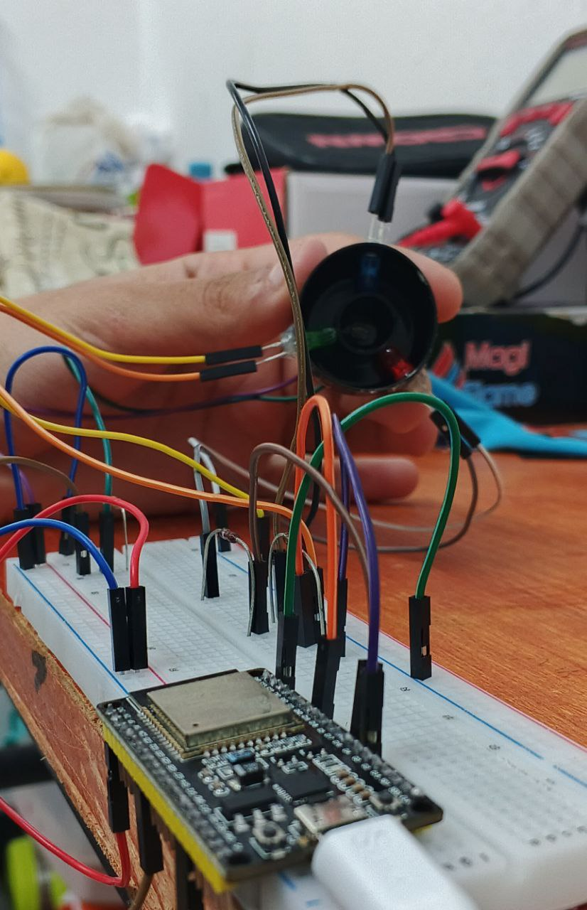

# ESP32-Based RGB Reflectance Color Detection System

**Design and Implementation of a Sequential RGB Illumination and LDR-Based Color Classification System**

<p align="center">
  
</p>

<p align="center">
  
  
  
  
  
</p>

## 1. Project Overview

This project presents the design and implementation of an **RGB reflectance-based color detection system** using an ESP32 microcontroller, three RGB illumination LEDs, and a Light Dependent Resistor (LDR).

The system identifies the color of an object by sequentially illuminating its surface with red, green, and blue light. The LDR measures the reflected light intensity for each illumination channel, generating three analog measurements corresponding to the RGB channels.

The ESP32 processes these measurements and compares them with a predefined calibration dataset. Color identification is performed using an interval-based classification algorithm, in which each color is associated with specific ranges of RGB measurements.

In addition to the electronic system, a custom geometrical enclosure was designed using **Autodesk Fusion 360**. The 3D design integrates the LDR and the three LEDs into a dedicated sensing structure, providing a defined arrangement for illumination and light detection.

The project combines analog sensing, embedded programming, experimental calibration, electronic circuit design, and mechanical design.

## 2. Project Objectives

The main objectives are:

- Develop an RGB reflectance-based color detection system.
- Implement sequential illumination using three independent LEDs.
- Measure reflected light intensity using an LDR.
- Acquire analog measurements using the ESP32 ADC.
- Develop an interval-based color classification algorithm.
- Establish experimental measurement ranges for different colors.
- Design the electronic circuit using EasyEDA.
- Develop a custom 3D enclosure for the optical sensing arrangement.
- Integrate the electronic and mechanical components into a functional prototype.

## 3. Operating Principle

### 3.1 RGB Sequential Illumination

The system uses three LEDs to illuminate the target object independently.

Instead of activating all LEDs simultaneously, the ESP32 activates one LED at a time:

1. Red LED illumination.
2. Green LED illumination.
3. Blue LED illumination.

During each illumination stage, the LDR measures the intensity of the reflected light.

This produces three analog measurements:

$$
R = ADC_{\text{Red}}
$$

$$
G = ADC_{\text{Green}}
$$

$$
B = ADC_{\text{Blue}}
$$

The resulting RGB measurement vector is:

$$
\mathbf{X}=[R,G,B]
$$

These values are used as the input of the color classification algorithm.

### 3.2 Light Detection Using an LDR

The Light Dependent Resistor changes its electrical resistance according to the incident light intensity.

The LDR is connected in a voltage-divider circuit with a fixed resistor. The resulting voltage is measured by the ESP32 analog input.

The ADC reading depends on the illumination conditions and the voltage-divider configuration.

Consequently, the measured values are experimentally calibrated rather than treated as universal RGB color values.

### 3.3 Color Classification Algorithm

The firmware uses an interval-based classification method.

Each color is represented by six boundaries:

- Minimum and maximum red measurements.
- Minimum and maximum green measurements.
- Minimum and maximum blue measurements.

A color is detected when all three measurements fall within the corresponding intervals.

For a given color:

$$
R_{\min}\leq R\leq R_{\max}
$$

$$
G_{\min}\leq G\leq G_{\max}
$$

$$
B_{\min}\leq B\leq B_{\max}
$$

If all three conditions are satisfied, the corresponding color is identified.

Otherwise, the system returns:

```text
Detected Color: UNKNOWN
```

This approach uses experimentally defined measurement intervals instead of a conventional digital RGB color-space conversion.

## 4. System Architecture

<p align="center">
  
</p>

The system consists of four main functional blocks:

| Block | Function |
|---|---|
| RGB Illumination | Sequentially illuminates the target using red, green, and blue LEDs. |
| Optical Detection | Measures reflected light using the LDR. |
| Digital Processing | Acquires analog readings and performs color classification using the ESP32. |
| Mechanical Structure | Positions the LEDs and LDR within the custom-designed enclosure. |

## 5. Hardware Implementation

### 5.1 Main Components

| Component | Description |
|---|---|
| ESP32-WROOM-32 | Main controller and analog data acquisition |
| Red LED | Red illumination channel |
| Green LED | Green illumination channel |
| Blue LED | Blue illumination channel |
| 3 × 220 Ω resistors | LED current-limiting resistors |
| LDR | Reflected-light detection |
| 10 kΩ resistor | LDR voltage-divider resistor |
| Breadboard | Initial circuit assembly |
| Jumper wires | Electrical connections |

### 5.2 ESP32 Pin Configuration

| Component | ESP32 Pin | Function |
|---|---|---|
| Green LED | GPIO21 | Green illumination control |
| Red LED | GPIO17 | Red illumination control |
| Blue LED | GPIO16 | Blue illumination control |
| LDR | GPIO32 | Analog light measurement |

GPIO32 is used as an ADC input to acquire the analog voltage generated by the LDR voltage-divider circuit.

### 5.3 Electronic Circuit Design

The electronic circuit was designed using **EasyEDA**.

The three LEDs are controlled independently by the ESP32, allowing sequential activation of each illumination channel.

The LDR and its voltage-divider resistor provide an analog signal to the ESP32.

<p align="center">
  
</p>

*Figure: Electronic circuit schematic designed using EasyEDA.*

## 6. Mechanical Design and 3D Enclosure

A custom mechanical structure was designed using **Autodesk Fusion 360**.

The purpose of this design is to integrate the three illumination LEDs and the LDR into a geometrically arranged sensing structure.

The enclosure provides dedicated positions for:

- Red LED.
- Green LED.
- Blue LED.
- LDR optical detection element.

The geometrical arrangement is intended to provide a consistent illumination and detection configuration when positioning an object in front of the sensor.

This mechanical design is an important part of the project because the relative positions of the light sources, detector, and target influence the reflected-light measurements.

<p align="center">
  
  
</p>

<p align="center">
  <em>Figure: 3D mechanical design of the RGB illumination and LDR sensing assembly, shown from two different views.</em>
</p>

## 7. Software Implementation

The firmware is developed using the Arduino framework in the Arduino IDE.

The ESP32 performs the following operations:

- Initializes the LED output pins.
- Activates the green LED and acquires the LDR reading.
- Activates the red LED and acquires the LDR reading.
- Activates the blue LED and acquires the LDR reading.
- Compares the three measurements with the calibration dataset.
- Identifies the corresponding color or returns UNKNOWN.
- Transmits the measurements and classification result through the Serial Monitor.

### 7.1 Sequential Measurement

A delay of 500 ms is introduced after activating each LED to allow the illumination and sensor reading to stabilize before acquisition.

The measurements are obtained using:

```cpp
int G = analogRead(ldrPin);
int R = analogRead(ldrPin);
int B = analogRead(ldrPin);
```

Each reading is acquired while its corresponding LED is active.

### 7.2 Calibration Dataset

The firmware defines a structure containing the name and measurement boundaries of each color:

```cpp
struct Color {
    String name;
    int Rmin, Rmax;
    int Gmin, Gmax;
    int Bmin, Bmax;
};
```

The current calibration dataset contains seven predefined color classes:

| Color | R Range | G Range | B Range |
|---|---:|---:|---:|
| RED | 200–400 | 0–10 | 0–100 |
| GREEN | 0–70 | 70–150 | 100–200 |
| BLUE | 0–10 | 0–100 | 300–1000 |
| ORANGE | 200–400 | 15–100 | 10–100 |
| PURPLE | 50–150 | 0–50 | 200–400 |
| WHITE | 200–1000 | 200–1000 | 500–1000 |
| BLACK | 0–10 | 0–10 | 0–10 |

These intervals are experimental classification thresholds and depend on the illumination, LDR characteristics, circuit configuration, and measurement conditions.

### 7.3 Classification Process

The firmware iterates through the calibration dataset and checks whether the three acquired values fall within the corresponding boundaries.

The classification condition is implemented as:

```cpp
if (R >= colors[i].Rmin && R <= colors[i].Rmax &&
    G >= colors[i].Gmin && G <= colors[i].Gmax &&
    B >= colors[i].Bmin && B <= colors[i].Bmax) {

    Serial.print("Detected Color: ");
    Serial.println(colors[i].name);

    found = true;
    break;
}
```

If no color satisfies all three conditions, the system reports UNKNOWN.

### 7.4 Uploading the Firmware

1. Open `color_checker_code.ino` in Arduino IDE.
2. Select the board: **ESP32 Dev Module**.
3. Select the correct COM port.
4. Upload the firmware.
5. Open the Serial Monitor at **115200 baud** to observe the measurements and classification result.

## 8. Experimental Operation

During operation, the system performs a complete RGB measurement sequence:

1. The green LED is activated and the LDR reading is recorded.
2. The green LED is switched off.
3. The red LED is activated and its corresponding reading is recorded.
4. The red LED is switched off.
5. The blue LED is activated and its corresponding reading is recorded.
6. The three readings are compared against the predefined calibration intervals.
7. The detected color is printed through the Serial Monitor.

Example output:

```text
Green LED value: ...
Red LED value: ...
Blue LED value: ...
Detected Color: RED
```

The current firmware performs this sequence once during `setup()`. The `loop()` function is empty, so continuous color detection is not implemented in this version.

## 9. Project Images

### 9.1 Real Hardware Implementation

<p align="center">
  
</p>

*Figure: Experimental hardware implementation using the ESP32, RGB LEDs, and LDR.*

### 9.2 EasyEDA Circuit Design

<p align="center">
  
</p>

### 9.3 Fusion 360 Mechanical Design

<p align="center">
  
</p>

## 10. Repository Structure

```text
esp32-rgb-color-detection/
│
├── README.md
│
├── firmware/
│   └── color_checker_code.ino
│
├── hardware/
│   ├── easyeda/
│   │   └── circuit-schematic.pdf
│   │
│   └── components/
│       └── bill-of-materials.md
│
├── mechanical-design/
│   ├── fusion360/
│   │   └── rgb_sensor_enclosure.f3d
│   │
│   └── exports/
│       ├── rgb_sensor_enclosure.step
│       └── rgb_sensor_enclosure.stl
│
├── images/
│   ├── project-banner.png
│   ├── real-hardware.jpg
│   ├── easyeda-schematic.png
│   ├── fusion360-design.png
│   └── system-block-diagram.png
│
└── simulation/
    └── simulation-screenshots/
```

## 11. Limitations and Future Improvements

### Current Limitations

- Color classification depends on experimentally defined measurement intervals.
- LDR response depends on illumination intensity and environmental conditions.
- The system is sensitive to the distance and orientation of the target object.
- The current firmware performs one measurement sequence during initialization rather than continuous detection.
- The classification algorithm does not currently implement normalization or adaptive calibration.
- The measured values are sensor-dependent and should not be interpreted as standard RGB color coordinates.

### Future Improvements

- Implement continuous color detection.
- Expand the experimental calibration dataset.
- Improve the optical enclosure and LED positioning.
- Investigate ambient-light compensation.
- Implement measurement averaging and digital filtering.
- Develop a more flexible classification algorithm.
- Evaluate the influence of target distance and surface properties.
- Integrate the sensor and electronic circuit into a dedicated PCB.

## 12. Tools and Technologies

**Hardware**
- ESP32-WROOM-32
- RGB LEDs
- LDR (Photoresistor)
- Analog electronic components

**Software and Design**
- Arduino IDE
- C/C++
- EasyEDA
- Autodesk Fusion 360

## 13. Project Documentation

The repository includes the following project resources:

- Arduino firmware.
- EasyEDA electronic schematic.
- Simulation screenshots.
- Real hardware implementation photographs.
- Fusion 360 mechanical design files.
- 3D model exports.

## 14. Author

**Abderraouf Brada**

Electronics and Sensors Engineering Student  
Interested in analog electronics, sensor systems, instrumentation, and robotics.

- GitHub: [abderraoufbrada](https://github.com/abderraoufbrada)
- LinkedIn: [Abderraouf Brada](https://www.linkedin.com/in/abderraouf-brada-16bab632a/)

---

*This project demonstrates an experimental embedded color detection approach combining sequential RGB illumination, analog optical sensing, interval-based classification, and custom mechanical design.*
